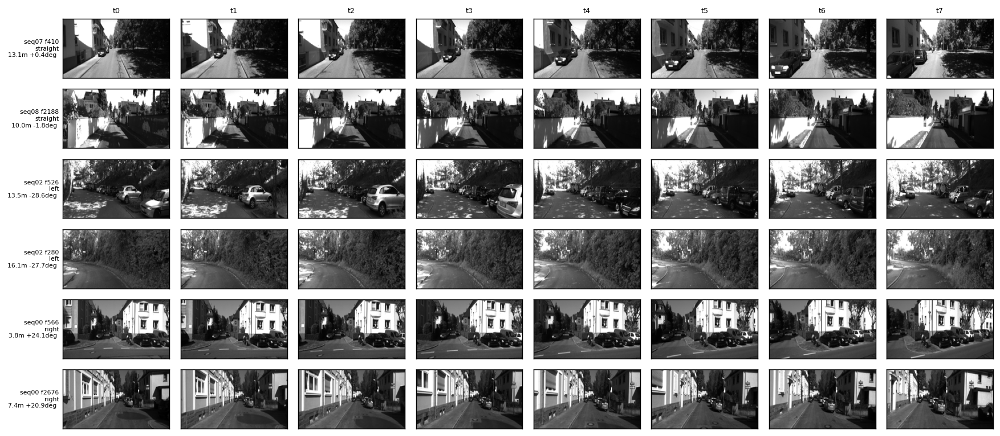
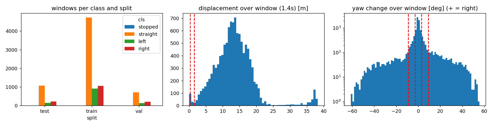
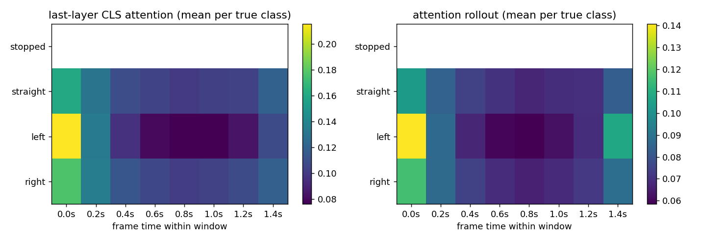
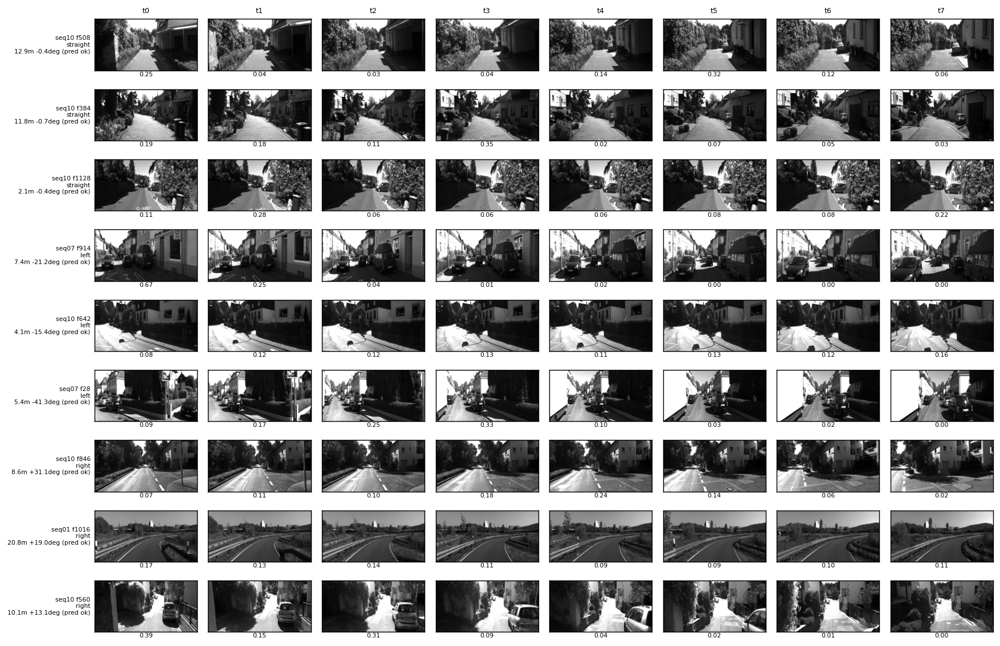
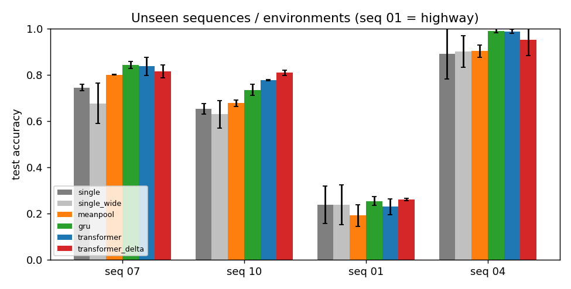
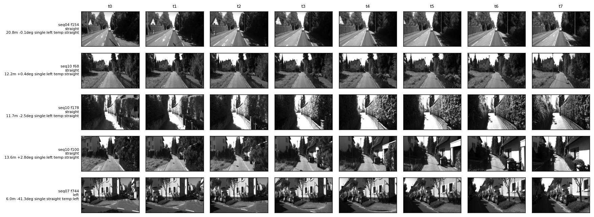
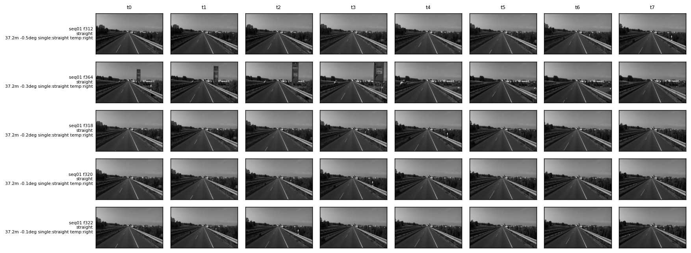
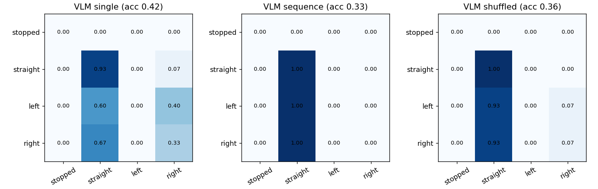

# Does a sequence of frames tell you more than a single frame?

An experiment on KITTI odometry. I take short windows of driving video, embed every frame with a frozen DINOv2 encoder, and compare a classifier that sees one frame with small GRU and Transformer heads that see eight. The target is the car's ego-motion over the window: straight, left or right.

The short version of what I found: the temporal models are clearly better than a single frame (macro-F1 about 0.58 against 0.42), but they get there by comparing frames, mostly the first one against the rest, not by following the order of events. Details, controls and caveats are below.


## Contents
1. [Task and labels](#task-and-labels)
2. [Data](#data)
3. [Method](#method)
4. [Results](#results)
5. [What I take from this](#what-i-take-from-this)
6. [Limitations](#limitations)
7. [Setup and reproduction](#setup-and-reproduction)
8. [Parameters](#parameters)
9. [Repository layout](#repository-layout)

## Task and labels

A sample is a window of 8 frames taken every second frame of the 10 Hz recording, so frames are 0.2 s apart and the window covers 1.4 s. The label comes from the ground-truth poses: I compute the relative pose between the first and the last frame of the window and look at the distance travelled and the yaw change.

| label | rule |
|---|---|
| right | yaw change > 9 deg, at least 1.5 m travelled |
| left | yaw change < -9 deg, at least 1.5 m travelled |
| straight | abs(yaw change) < 3 deg, at least 1.5 m travelled |
| dropped | everything else (yaw between 3 and 9 deg, slow creeping, standing still) |

The dead zone is there on purpose. My first version used a single 6 degree threshold and a lot of labels were decided by a fraction of a degree. There is also a four-class mode (`--mode 4class`) that adds `stopped` (< 0.3 m), but KITTI odometry only has a few dozen stationary windows, which is not enough to evaluate anything, so the default is three classes.

The label is defined over the whole window, so one frame cannot define it. That does not mean a single frame is useless: road curvature and layout carry a lot of information, which is why the single-frame baseline is a fair opponent and not a straw man.

## Data

I use the grayscale left camera (`image_0`) of the KITTI odometry benchmark with the ground-truth poses of sequences 00 to 10. The data is not in this repository, see [setup](#setup-and-reproduction).

The splits are by sequence, so overlapping windows never leak from training into testing. Sequence 01 is a highway drive that looks nothing like the rest, and I kept it in the test set on purpose as an environment shift.


| split | sequences | windows | straight | left | right |
|---|---|---|---|---|---|
| train | 00, 02, 03, 05, 08 | 6709 | 4731 | 915 | 1063 |
| val | 06, 09 | 1054 | 715 | 138 | 201 |
| test | 07, 10, 01, 04 | 1431 | 1067 | 142 | 222 |

Examples of windows per class (generated by `prepare_data_step01.py`):



Distance and yaw distributions with the thresholds marked:



The first script also checks the sequences before anything else is done: contiguous frame ids, equal numbers of frames, poses and timestamps, strictly increasing timestamps, constant image size. The result goes to `results/tables/integrity.csv`.

One thing that motivated the whole setup: in an early four-class run, a stationary car and a slowly moving car had almost identical last frames (embedding cosine 0.985 to 0.999). A single frame cannot tell them apart. The figure below is from that early run, it is not part of the final three-class task.


## Method

**Frame embeddings.** Each frame goes through a frozen DINOv2 ViT-S/14 (`facebook/dinov2-small`). The grayscale image is repeated to three channels and resized to 224 x 742, which keeps the KITTI aspect ratio without cropping. The embedding is the class token concatenated with the mean patch token (768 values). I cache it once and standardise with training statistics only.

**Heads.** Everything trained on top of the embeddings is small.

| model | what it sees | params |
|---|---|---|
| `single` | one frame (a random frame of the window during training) | 197,892 |
| `single_wide` | one frame, widened to the Transformer's size (capacity control) | 364,860 |
| `meanpool` | the mean of all 8 frames, no order and no comparison | 197,892 |
| `gru` | the 8 frames, one-layer GRU | 198,020 |
| `transformer` | the 8 frames, 2 layers, class token, learned positions | 365,316 |
| `transformer_nopos` | same without positions, so it sees a set | 365,316 |
| `gru_delta` | each frame plus its difference to the previous one | 296,324 |
| `transformer_delta` | same input as `gru_delta`, Transformer head | 463,620 |

The controls are the interesting part. `single_wide` answers "is it just a bigger network?", `meanpool` answers "is it just more frames?", and `transformer_nopos` answers "does it need the order, or only the other frames?".

**Training.** Class-weighted cross-entropy, AdamW, cosine schedule, early stopping on validation macro-F1, three seeds. Macro-F1 is the main metric because about 75 percent of the windows are straight. Windows overlap heavily, so the spread over seeds understates the uncertainty. I therefore also report 95 percent block-bootstrap intervals (5 s blocks, 2000 resamples) of the three-seed ensemble, and paired differences against the single-frame model.

## Results

Test set, 1431 windows from four unseen sequences.

| model | accuracy | macro-F1 (3 seeds) | macro-F1 ensemble [95% CI] | difference to `single` [95% CI] |
|---|---|---|---|---|
| single (last frame) | 0.557 +- 0.039 | 0.418 +- 0.010 | 0.409 [0.324, 0.492] | |
| single_wide | 0.532 +- 0.062 | 0.407 +- 0.026 | 0.411 [0.321, 0.497] | +0.001 [-0.033, +0.035] |
| meanpool | 0.565 +- 0.022 | 0.447 +- 0.021 | 0.444 [0.345, 0.538] | +0.035 [-0.006, +0.078] |
| gru | 0.623 +- 0.017 | 0.581 +- 0.019 | 0.585 [0.480, 0.678] | +0.173 [+0.095, +0.245] |
| transformer | 0.624 +- 0.021 | 0.578 +- 0.040 | 0.617 [0.517, 0.703] | +0.205 [+0.140, +0.272] |
| transformer_nopos | 0.625 +- 0.011 | 0.584 +- 0.017 | 0.612 [0.509, 0.696] | +0.199 [+0.132, +0.267] |
| gru_delta | 0.657 +- 0.006 | 0.577 +- 0.021 | 0.579 [0.454, 0.690] | +0.168 [+0.096, +0.237] |
| transformer_delta | 0.634 +- 0.018 | 0.571 +- 0.027 | 0.587 [0.483, 0.674] | +0.175 [+0.098, +0.251] |

The single-frame row is evaluated on the last frame. Averaged over whichever frame it is shown, it reaches 0.444 (0.436 for `single_wide`), so the honest size of the temporal advantage is closer to +0.13.


*Left: test macro-F1 with bootstrap intervals. Right: one model per number of observed frames k (the most recent k of the 8). Performance only jumps once the window covers the whole 1.4 s the label is defined on.*

### Is the order used?

Same models, test windows fed in the correct order, shuffled, or reversed in time. The swap rate is the share of left and right windows predicted as the opposite turn; if direction came from temporal order, reversal should push it towards 1.

| model | correct | shuffled | reversed | left/right swap rate, correct to reversed |
|---|---|---|---|---|
| single (last frame) | 0.418 | 0.447 | 0.462 | 0.151 to 0.172 |
| meanpool | 0.447 | 0.447 | 0.447 | 0.109 to 0.109 |
| gru | 0.581 | 0.555 | 0.536 | 0.095 to 0.126 |
| transformer | 0.578 | 0.569 | 0.563 | 0.136 to 0.134 |
| transformer_nopos | 0.584 | 0.584 | 0.584 | 0.099 to 0.099 |
| gru_delta | 0.577 | 0.493 | 0.449 | 0.059 to 0.169 |
| transformer_delta | 0.571 | 0.523 | 0.482 | 0.102 to 0.158 |


*Left: shuffling and reversing the window. Right: macro-F1 lost when one frame is replaced by the training mean. For the Transformer it is almost all in the first frame.*

The class-token attention agrees with the ablation. It puts 0.168 of its weight on the first frame against 0.098 to 0.119 elsewhere, and the pattern barely changes when the frames are shuffled:





### Robustness and environments

Half of the frames of the test sequences are corrupted (blur, noise, partial occlusion) or dropped. Models are trained on clean data only.


At moderate corruption the temporal models stay ahead of the single frame, but they lose more. Under the strongest noise they fall below it. The frame-drop rows are too optimistic, because my implementation never drops the first frame, which is the one that matters.

Excluding highway sequence 01, the temporal models lead clearly (macro-F1: single 0.569, GRU 0.689, Transformer 0.721). On sequence 01 nothing works, every model stays between 0.20 and 0.25.



### Where it helps and where it does not

Recall per class, ensemble Transformer against the single frame: left 0.42 to 0.76, right 0.28 to 0.72, straight 0.63 to 0.62. Out of 1431 test windows the temporal model fixes 218 windows the single frame got wrong, breaks 87, and 416 are wrong for both.





### Vision-language model

Qwen2-VL-2B, zero-shot, on 45 balanced test windows. Asked for one word (straight, left or right) it scores 0.42 on the last frame, 0.33 on the eight frames in order and 0.36 shuffled. With the sequence prompt it answered "straight" every single time, so it sits exactly at chance. The embedding models score 0.38 (single frame) and 0.64 (Transformer) on the same windows. With 45 windows the uncertainty is around 15 points, so I read this as "no usable motion signal from this model", not as a measurement of the VLM's limits. Free-text descriptions are in `results/vlm/vlm_descriptions.md`.



## What I take from this

- Temporal models beat a single frame on this task, and the capacity-matched control shows it is not parameter count.
- Most of that gain is not about order. A Transformer that cannot see positions is as good as the ordered one, and shuffling hardly matters for plain embeddings.
- The models behave like first-versus-rest comparators, which is also exactly how the label is defined (first frame to last frame). An endpoint comparison solves the task as posed.
- When given explicit frame differences, the models do become order-sensitive, but they do not get more accurate, and direction is only partly read from order.
- The gain does not survive a change of environment (highway) and shrinks under heavy noise.

## Limitations

- Small and imbalanced test set (142 left and 222 right windows), overlapping windows, three seeds.
- The label is built from the first and last frame, so the experiment cannot show deeper sequence reasoning. A two-frame baseline (first and last frame only) would test this directly; I have not run it yet.
- Global DINOv2 tokens discard geometry. Spatially pooled patch features are implemented (`--feat grid`) but not evaluated.
- Label thresholds (3 and 9 degrees, 1.5 m) are my choice. I also changed the label definition and added the delta models after looking at an earlier run, so the final test numbers are probably slightly optimistic.
- The VLM sample is small.

## Setup and reproduction

```bash
python -m venv .venv
source .venv/bin/activate        # Windows: .venv\Scripts\activate
pip install -r requirements.txt  # install a CUDA build of torch from pytorch.org first if you have a GPU
```

**Data.** Download `data_odometry_gray.zip` and `data_odometry_poses.zip` from the [KITTI odometry page](https://www.cvlibs.net/datasets/kitti/eval_odometry.php) and unzip both into `data/kitti/`, so that you end up with:

```
data/kitti/dataset/sequences/00/image_0/000000.png
data/kitti/dataset/sequences/00/times.txt
data/kitti/dataset/poses/00.txt
```

Or pass `--data_root /your/path` to every script. KITTI has its own license and is not redistributed here.

**Run the steps in order.** Every script accepts the shared options listed under [Parameters](#parameters).

```bash
python scripts/prepare_data_step01.py                            # integrity checks, statistics, frame strips
python scripts/extract_embeddings_step_02.py --corruptions all --frac 0.5
python scripts/analyze_embeddings_03.py                          # cosine similarity, drift, PCA, pooling
python scripts/train_step04.py --seeds 3                         # all models + bootstrap intervals
python scripts/run_experiments_step05.py --seeds 3               # progressive, order, ablation, corruption, per-sequence
python scripts/attention_viz_step06.py --model transformer       # also: --model transformer_delta
python scripts/failure_cases_step07.py
python scripts/vlm_experiment_step08.py                          # downloads Qwen2-VL-2B (about 4.5 GB)
python scripts/architecture_diagram_step09.py
```

Embedding extraction is the slow part (it runs DINOv2 over all frames, once). Training on cached embeddings is fast. Seeds are fixed (0, 1, 2) and the corruptions are deterministic per sequence and frame, so the numbers above should be reproducible up to GPU non-determinism.

Outputs land in `results/`: `main_results.json`, `bootstrap.json`, `experiments/*.json`, `tables/`, `figures/`, `vlm/`. Checkpoints go to `results/checkpoints/` and are git-ignored.

A quick end-to-end check without the dataset is possible with `python scripts/make_synthetic_kitti.py` and the dummy encoder (`--encoder dummy`), which is only meant to test that the code runs.

## Parameters

Data and labels (`src/config.py`, all overridable from the command line):

| parameter | value | flag |
|---|---|---|
| frames per window | 8 | `--T` |
| frame gap inside a window | 2 frames (0.2 s) | `--gap` |
| window stride | 2 frames | `--stride` |
| yaw for straight / for a turn | < 3 deg / > 9 deg | `--yaw_lo`, `--yaw_hi` |
| minimum travel for a moving window | 1.5 m | `--move_disp` |
| stopped threshold (4-class mode only) | 0.3 m | `--stop_disp` |
| label mode | 3class | `--mode` |
| input size | 224 x 742 | `src/config.py` |
| embedding | CLS + mean patch, 768-d | `--feat cls\|clsmean\|grid` |
| encoder | dinov2-small | `--encoder` |

Models and training:

| parameter | value |
|---|---|
| optimiser | AdamW, lr 1e-3, weight decay 1e-2, cosine schedule |
| batch size / epochs / patience | 256 / 40 / 8 (early stopping on validation macro-F1) |
| loss | cross-entropy with inverse-frequency class weights |
| MLP heads | hidden 256, dropout 0.2 |
| GRU | 1 layer, width 128, dropout 0.2 |
| Transformer | 2 layers, 4 heads, width 128, MLP ratio 2, dropout 0.1, class token |
| delta input | `[E_t ; 3 * (E_t - E_{t-1})]`, first delta is 0 |
| seeds | 3 |

Evaluation:

| parameter | value |
|---|---|
| bootstrap | 5 s blocks (50 frames), 2000 resamples, 95 percent percentile intervals |
| corruption | blur sigma 3 / 8 px, noise std 0.10 / 0.30, occlusion 25 / 50 percent of the image, applied to a random 50 percent of frames |
| frame drops | 25 / 50 percent, repeat previous embedding or replace with the training mean |
| VLM | Qwen2-VL-2B-Instruct, frames resized to 644 x 196, greedy decoding, 45 windows |

## Repository layout

```
src/config.py           configuration and shared command-line options
src/data/               KITTI loading, integrity checks, labels, windows, frame strips
src/embeddings/         frozen encoders, corruptions, caching
src/models/             single-frame and temporal heads
src/evaluation/         training, metrics, block bootstrap
src/vlm/                Qwen2-VL wrapper and answer parsing
scripts/                the numbered steps listed above
docs/images/            diagrams used in this README
results/                tables, figures, predictions, VLM outputs
report.pdf              the written report
```


*A sketch of how I would grow this into a larger multimodal system: separate encoders per sensor, a streaming temporal model, cross-modal fusion, and a VLM on top for description and ambiguity flags. It is a design sketch, nothing in it beyond the video branch is implemented here.*

## Acknowledgements

KITTI odometry benchmark (Geiger, Lenz, Urtasun), DINOv2 (Meta AI) and Qwen2-VL (Alibaba), both used through the Hugging Face `transformers` library, frozen or zero-shot. No model was fine-tuned.
